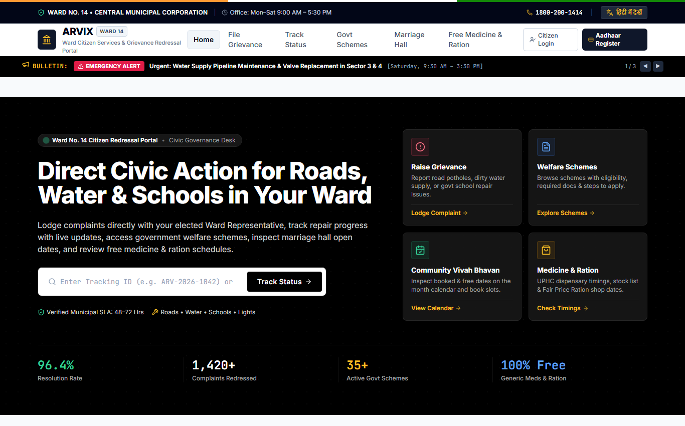
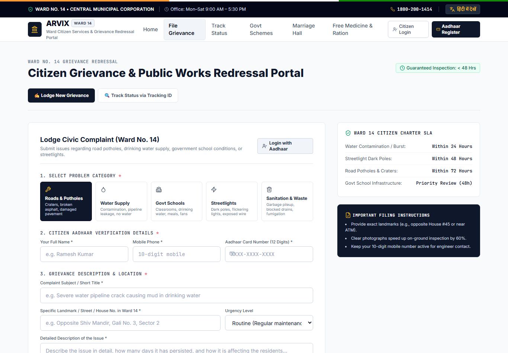
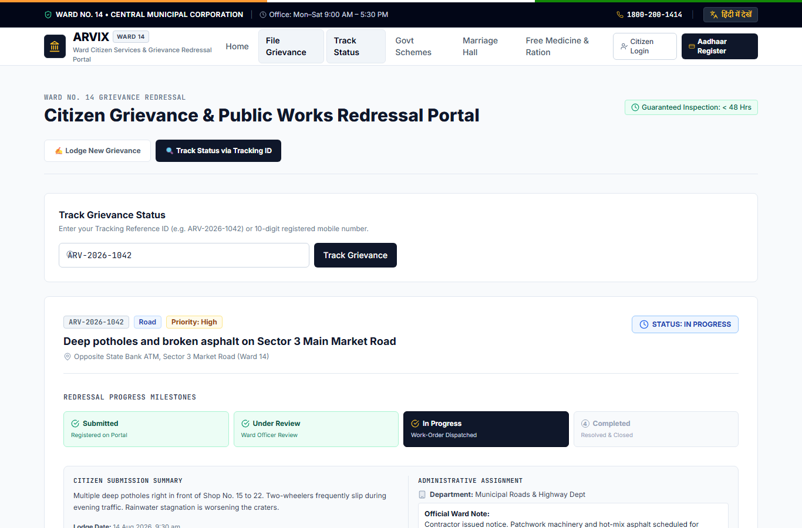
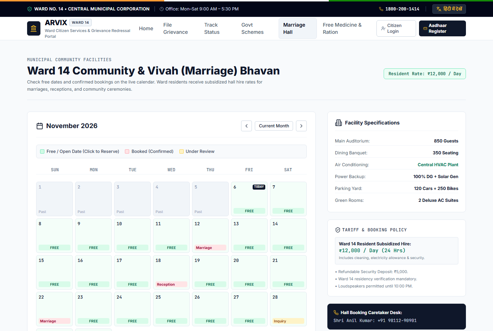
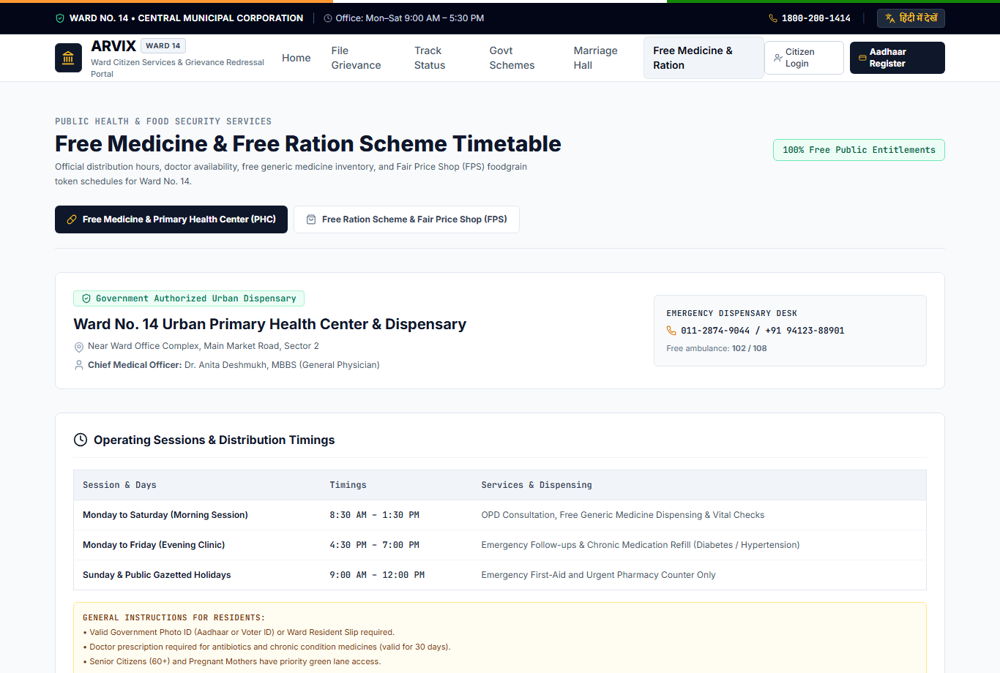
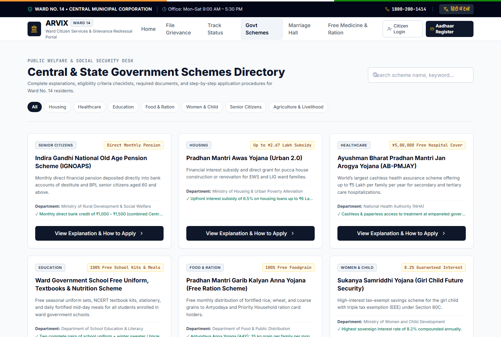
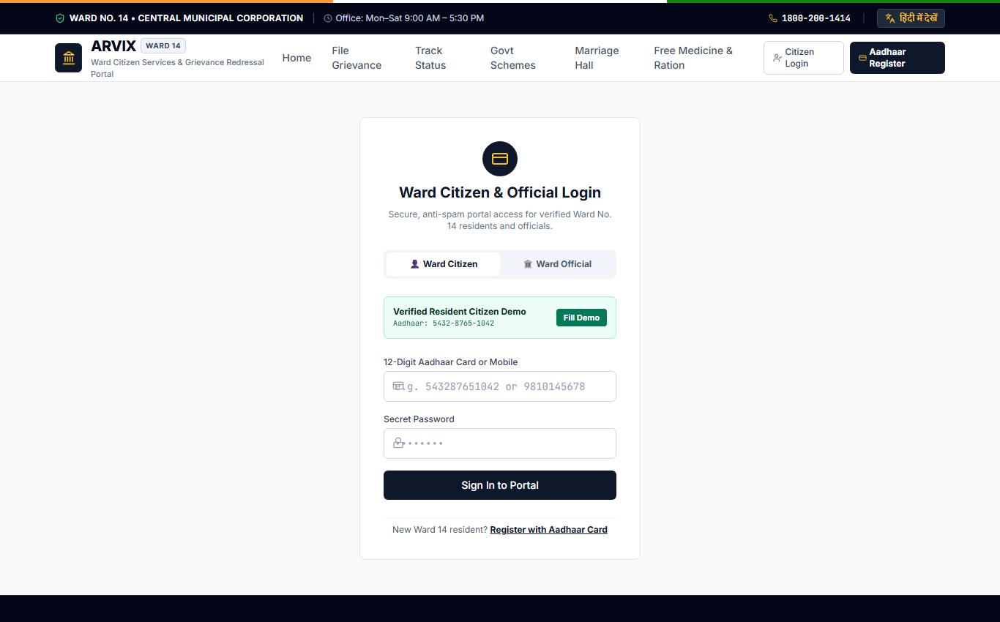

# ARVIX — Ward Citizen Services & Grievance Redressal Portal

ARVIX is a hyper-local e-governance and community management portal built with the **MERN Stack** (MongoDB, Express, React, Node.js). Designed specifically for ward residents and ward representatives (Councilors / Corporators / Ward Officers), ARVIX facilitates transparent civic governance, seamless grievance resolution, and community facility access.

---

## 📸 Visual Tour & Application Screenshots

### 1. Civic Homepage & Deep Black Hero Section
*Features national tricolor civic strip, live bulletin marquee, quick tracking search, 4 service action pillars, and Ward Representative desk.*



---

### 2. Citizen Grievance Redressal (Lodge Complaint)
*Category selection (Roads, Water, Govt Schools, Streetlights, Sanitation), Aadhaar resident auto-fill, and photo attachment dropzone.*



---

### 3. Live 4-Milestone Grievance Progress Stepper
*Real-time tracking timeline (`Submitted` → `Under Review` → `In Progress` → `Completed`) with assigned department and official audit trail.*



---

### 4. Community & Vivah Bhavan (Marriage Hall) Month Calendar
*Interactive month-view calendar highlighting **Green Free Dates** vs. **Red Booked Dates**, amenities specifications, and subsidized booking request modal.*



---

### 5. Free Medicine & Fair Price Ration Shop Timetable
*Urban Primary Health Center dispensary operating hours, searchable free generic medicine inventory, and Fair Price Shop 412 crowd-free token timetable.*



---

### 6. Central & State Government Welfare Schemes Directory
*Directory with category tabs, search filtering, and comprehensive modal explaining policy objectives, benefits checklist, required documents, and steps to apply.*



---

### 7. Aadhaar-Verified Citizen & Representative Login
*Anti-spam authentication enforcing 12-digit Aadhaar Card verification for Ward 14 residents and official email access for ward representatives.*



---

## 🏛️ Core Features

- **Anti-Spam Aadhaar Resident Verification**:
  - Enforces 12-digit Aadhaar Card verification to restrict access strictly to Ward No. 14 residents.
  - Masks Aadhaar (`XXXX-XXXX-1042`) for privacy and automated audit integrity.
  - Dedicated resident account portal showing personal complaint histories and hall booking statuses.

- **Bilingual Accessibility (हिंदी / English)**:
  - One-click dynamic language toggle (`English | हिन्दी`) across all headers, forms, status steppers, and schedules.
  - Authentic administrative Hindi terminology (*शिकायत दर्ज करें, समीक्षाधीन, प्रगति पर, निस्तारित, विवाह भवन, उचित दर राशन डिपो*).

- **Grievance Redressal (Complaints)**:
  - Categories: Road Damage & Potholes, Water Supply & Pipeline Leaks, Government School Infrastructure, Sanitation & Waste Management, Streetlight & Electricity.
  - Photo attachment, exact landmark details, and automatic unique Tracking ID (`ARV-2026-XXXX`).
  - Live 4-stage tracking timeline (`Submitted` → `Under Review` → `In Progress` → `Completed` / `Rejected`).
  - Ward Representative administrative control to review, assign, add resolution notes, and update statuses.

- **Government Schemes Directory**:
  - Detailed explanations of national and state public welfare schemes (Education, Healthcare, Housing, Women & Child, Senior Citizens, Ration).
  - Breakdown of benefits, eligibility criteria checklist, required documentation, and step-by-step application instructions (Online & Ward Office counters).

- **Hero Banner, Announcements & Ward Functions**:
  - Deep black institutional hero styling (`bg-black`).
  - Urgent alerts ticker (scheduled power/water maintenance, health advisories).
  - Ward Representative contact card and ward helpline details.
  - Public functions calendar (cultural events, cleanliness drives, public consultations).

- **Community & Vivah (Marriage) Hall Booking**:
  - Interactive month-view calendar highlighting **Booked Dates** (Red) vs. **Free / Available Dates** (Green).
  - Resident booking request form with event details and automated validation.
  - Ward Representative approval workflow.

- **Free Medicine Distribution Schedule**:
  - Ward Primary Health Center (PHC) and municipal dispensary timings.
  - Searchable live inventory of essential medicines provided free of charge.
  - Notices for upcoming specialized health camps (eye checkups, diabetes screening, vaccinations).

- **Free Ration Scheme Timings & Fair Price Shop (FPS)**:
  - Operating hours and distribution windows for local Fair Price Shops.
  - Monthly grain & staple quotas for Antyodaya (AAY) and Priority Household (PHH/BPL) ration cards under PMGKAY.
  - Token and card ending digit schedule to eliminate crowding.
  - Mandatory e-KYC guidelines and helpline information.

---

## 🛠️ Tech Stack

- **Frontend**: React 18, Vite, Tailwind CSS, Lucide React, React Router Dom, Axios
- **Backend**: Node.js, Express.js, MongoDB / Mongoose, JWT Authentication, Multer, bcryptjs, CORS
- **Resilient Fallback**: Tested and pre-seeded with in-memory JSON fallback support if local MongoDB is not running.
- **Design System**: Human-crafted civic trust palette, tabular font-mono, zero AI neon clichés.

---

## 🚀 Getting Started

### Prerequisites
- Node.js (v18+ recommended)
- MongoDB (Local instance or MongoDB Atlas connection URI)

### Installation
1. Clone the repository:
   ```bash
   git clone https://github.com/your-username/arvix.git
   cd arvix
   ```
2. Install all dependencies (root, backend, and frontend):
   ```bash
   npm run install-all
   ```
3. Configure environment variables in `server/.env`:
   ```env
   PORT=5000
   MONGODB_URI=mongodb://127.0.0.1:27017/arvix
   JWT_SECRET=arvix_civic_portal_super_secret_jwt_key_2026
   CLIENT_URL=http://localhost:5173
   ```
4. Start both servers concurrently:
   ```bash
   npm run dev
   ```
   - Client: `http://localhost:5173`
   - Server: `http://localhost:5000`

---

## 🔐 Demo Credentials

### 1. Ward Representative / Admin
- **Email**: `representative@arvix.gov.in`
- **Password**: `WardRep@2026`
- *(Or click the "Fill Demo" button on the official login tab)*

### 2. Verified Ward 14 Resident Citizen
- **Aadhaar Number**: `543287651042`
- **Password**: `Citizen@2026`
- *(Or click the "Fill Demo" button on the citizen login tab)*
